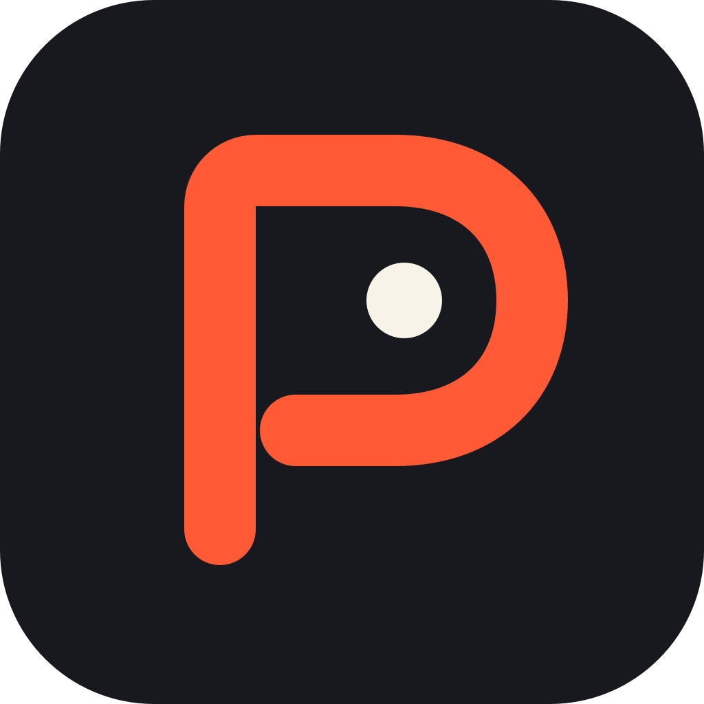
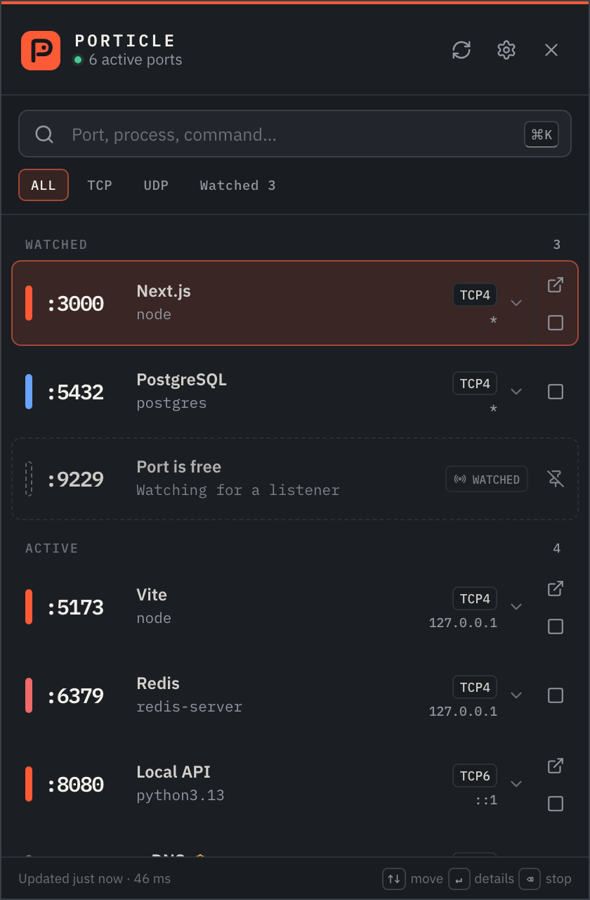
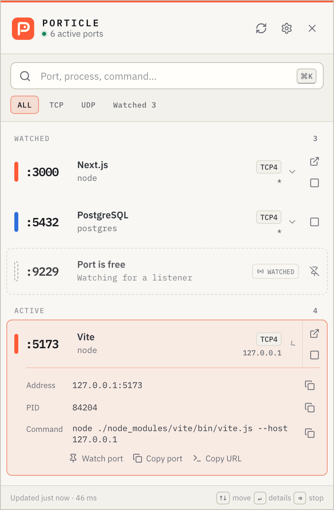

<p align="center">
  
</p>

<h1 align="center">Porticle</h1>

<p align="center"><strong>Local ports, without the terminal archaeology.</strong></p>

<p align="center">
  A fast, open-source menu bar and system tray app for seeing—and stopping—what is using your local ports.
</p>

<p align="center">
  macOS 13+ · Windows 10+ · TCP + UDP · IPv4 + IPv6 · No account · No telemetry
</p>

<p align="center">
  <a href="https://github.com/AmoonPod/porticle/actions/workflows/ci.yml"></a>
  <a href="https://github.com/AmoonPod/porticle/actions/workflows/codeql.yml"></a>
  <a href="https://github.com/AmoonPod/porticle/releases"></a>
  <a href="LICENSE"></a>
</p>

<table>
  <tr>
    <td></td>
    <td></td>
  </tr>
</table>

Porticle answers one question immediately: **what owns this port?** It lives where the answer should live—one click from the menu bar on macOS or the system tray on Windows. There is no dashboard to manage, daemon to install, or elevated background service to trust.

## What it does

- Lists listening TCP sockets and bound UDP endpoints across IPv4 and IPv6.
- Shows port, protocol, address, PID, process, full command, and recognizable service names.
- Recognizes common local tools and services such as Next.js, Vite, Astro, Django, Rails, PostgreSQL, Redis, MySQL, MongoDB, Docker, LocalStack, Storybook, Jupyter, and Ollama.
- Opens recognized web services at a validated `localhost` URL.
- Copies the port, PID, endpoint, command, or localhost URL.
- Stops a process tree gracefully, then force-stops it after a configurable delay if needed.
- Revalidates process identity before termination to avoid PID-reuse races.
- Detects ports that reopen under a supervisor or a replacement process.
- Searches ports, PIDs, processes, commands, protocols, and addresses as you type.
- Watches ports even while they are free and notifies when their owner changes.
- Supports system, light, and dark themes plus a customizable signal color.
- Starts at login, refreshes automatically, and opens from an optional global shortcut.
- Checks the official GitHub release channel and exposes download/restart controls only when an update exists.

## The interaction model

Porticle is deliberately small:

1. Click the tray icon.
2. Find the port—or type to filter.
3. Select a row and click **Stop**.

Confirmation is on by default and can be disabled for a one-click workflow. Click a row for command/address details. There are no background accounts, projects, historical charts, cloud checks, or bundled terminal emulators.

### Keyboard controls

| Key                                              | Action                                       |
| ------------------------------------------------ | -------------------------------------------- |
| <kbd>⌘/Ctrl</kbd> + <kbd>K</kbd> or <kbd>/</kbd> | Focus search                                 |
| <kbd>↑</kbd> / <kbd>↓</kbd>                      | Move through ports                           |
| <kbd>Enter</kbd>                                 | Expand or collapse details                   |
| <kbd>O</kbd>                                     | Open the selected localhost service          |
| <kbd>C</kbd>                                     | Copy its URL, or its port when no URL exists |
| <kbd>P</kbd>                                     | Watch or unwatch its port                    |
| <kbd>Backspace</kbd> / <kbd>Delete</kbd>         | Stop the selected process                    |
| <kbd>R</kbd>                                     | Refresh now                                  |
| <kbd>Escape</kbd>                                | Close the current layer, then hide Porticle  |

## Install

Signed and notarized macOS builds and signed Windows installers are produced from version tags by the release workflow. Download the build for your architecture from [GitHub Releases](https://github.com/AmoonPod/porticle/releases). Porticle checks that official release channel after startup and every six hours; download and restart always require explicit clicks.

Porticle currently targets:

- macOS 13 Ventura or newer on Apple silicon and Intel.
- Windows 10 or newer on x64 and ARM64.

Linux is intentionally out of scope for the first release. The discovery interface is platform-separated, so a Linux adapter can be proposed without changing renderer or termination contracts.

## Run from source

Requirements:

- Node.js 24 or newer.
- npm 11 or newer.
- macOS or Windows.

```bash
git clone https://github.com/AmoonPod/porticle.git
cd porticle
npm ci
npm run dev
```

Porticle uses the operating system’s existing network inventory:

- macOS: `/usr/sbin/lsof` plus `/bin/ps`.
- Windows: the built-in PowerShell `NetTCPIP` provider plus `Win32_Process` CIM data.

It does not install a driver, service, helper, or privileged daemon.

### Useful commands

```bash
npm run dev                 # Electron + renderer hot reload
npm run dev:renderer        # Browser-only UI with deterministic mock data
npm run typecheck           # Strict TypeScript
npm run lint                # Zero-warning ESLint
npm test                    # Unit and component tests
npm run test:e2e            # Playwright workflow tests
npm run build               # Production main/preload/renderer bundles
npm run build:app           # Package for the current platform
npm run package:mac:adhoc   # Runnable local macOS .app without a developer cert
npm run icons               # Regenerate .icns, .ico, PNG, and tray assets
npm run screenshots         # Regenerate the README screenshots
```

The macOS ad-hoc script is for local testing only. Published macOS builds must be Developer ID signed and notarized. Published Windows installers must be code signed.

## Permissions and protected processes

Porticle starts with ordinary user privileges and never elevates itself.

- Some system-owned processes can be listed but not stopped. They receive a shield marker and a disabled stop action.
- Other-user process metadata may be incomplete depending on OS policy.
- If macOS returns `EPERM` or Windows returns access denied, Porticle explains the failure and leaves the process untouched.
- If you decide a process should be stopped with administrator rights, do it explicitly in an administrator terminal. Porticle will not ask for a password or retain elevated access.

That boundary is intentional. A permanently elevated tray app would make the common workflow faster at the cost of a much larger blast radius.

## Safe termination

Every stop action is identity-bound to the exact row the user saw:

1. The renderer sends the endpoint key, PID, port, and a process token derived from its start time.
2. The main process performs a fresh socket/process scan.
3. If ownership changed, the request is rejected as stale.
4. Porticle sends a graceful request to the verified process tree (`SIGTERM` on macOS, `taskkill /T` on Windows).
5. If the same process remains after the configured delay, Porticle force-stops it (`SIGKILL` or `taskkill /F /T`).
6. A final scan verifies that the endpoint is free and reports if a supervisor reopened it.

No shell is involved. Executables are fixed, arguments are arrays, output is bounded, and every subprocess has a timeout.

## Architecture

```text
Sandboxed React renderer
        │ frozen, typed preload API
        ▼
Validated + sender-checked IPC
        │
        ▼
AppController ── PortMonitor ── macOS / Windows discovery
      │                │
      ├── Settings     └── watched-port transitions
      ├── Clipboard/browser allowlists
      ├── ProcessTerminator ── identity check ── graceful/force ── rescan
      └── UpdateManager ── fixed GitHub release channel ── explicit install
```

The renderer has no Node.js or raw Electron access. Production pages load from the secure custom `porticle://` protocol under a restrictive Content Security Policy. Navigation, new windows, browser permissions, and unvalidated external URLs are denied.

See [Architecture](docs/ARCHITECTURE.md), [Brand and product direction](docs/BRAND.md), [Release guide](docs/RELEASING.md), and [Security policy](SECURITY.md) for the complete decisions and threat model.

## Technology

- Electron 43 and Node.js 24
- TypeScript 6 with exact optional properties and unchecked-index protection
- React 19 and Vite 7 through electron-vite
- Zod 4 for IPC and persisted-settings validation
- electron-builder with ASAR integrity and hardened Electron fuses
- electron-updater with a fixed public GitHub release feed and manual install controls
- Vitest, Testing Library, and Playwright

The packaged runtime dependency tree is limited to electron-updater and its locked support packages.
React, Zod, Lucide, and IBM Plex fonts are compiled into the production bundles and are not shipped
as duplicate package trees. Porticle has no backend, account, telemetry, or sync traffic; only the
main process may contact GitHub's HTTPS release endpoints for update metadata and signed artifacts.

## Contributing

Start with [CONTRIBUTING.md](CONTRIBUTING.md). Bug reports should include the operating system, architecture, Porticle version, affected endpoint, and a redacted command if it contains secrets.

Security issues should **not** be filed publicly. Follow [SECURITY.md](SECURITY.md). General support
and reporting boundaries are documented in [SUPPORT.md](SUPPORT.md).

## License

[MIT](LICENSE) © 2026 Porticle contributors. See [third-party notices](THIRD_PARTY_NOTICES.md) for
the packaged dependency licenses.
