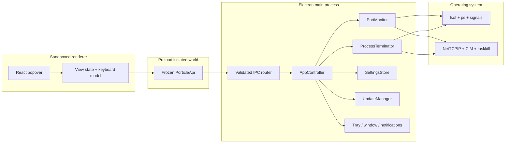

# Porticle architecture

This document describes the v0.1 architecture and the invariants a contribution must preserve.

## Product boundary

Porticle is a local socket inventory and process-stop tool. It is not a firewall, packet inspector, reverse proxy, process supervisor, container dashboard, or remote monitoring agent. The architecture follows that narrow boundary:

- no always-elevated helper;
- no daemon separate from Electron;
- no network backend, account, telemetry, or sync; the main process contacts only the fixed GitHub
  Releases feed for signed application updates;
- no active protocol probing;
- no shell command construction;
- no renderer access to Node.js or Electron primitives.

## Runtime topology



The renderer receives serializable snapshots and settings. It never receives command execution, filesystem, clipboard, shell, or generic IPC capabilities.

## Directory map

```text
src/
  main/
    controller.ts          application orchestration and allowlisted actions
    index.ts               single-instance and lifecycle entry point
    ipc.ts                 sender checks and per-channel Zod validation
    security.ts            custom protocol, CSP, navigation, permission denial
    tray.ts / window.ts    native tray and anchored popover behavior
    ports/
      macos.ts             lsof + ps adapter and parsers
      windows.ts           PowerShell NetTCPIP/CIM adapter and parsers
      normalize.ts         one cross-platform endpoint model
      services.ts          deterministic service recognition
      monitor.ts           non-overlapping refresh loop
    process/
      terminator.ts        identity-bound process-tree termination
    updater.ts             fixed GitHub release feed and explicit install state machine
    settings/
      store.ts             validated, atomic local JSON settings
    system/
      command.ts           no-shell, bounded, timed subprocess runner
  preload/
    index.ts               frozen typed context bridge
  renderer/
    src/                   React UI, browser mock, themes, keyboard workflow
  shared/
    model.ts               serializable contracts
    ipc.ts                 dependency-free channel allowlist for the sandboxed preload
    schemas.ts             IPC payload and settings validation
tests/
  unit/                    parser, normalization, safety, schema, component tests
  e2e/                     real-browser workflow tests
scripts/
  after-pack.mjs           least-privilege macOS plist hardening
```

## Port discovery

### macOS

The adapter starts four fixed `/usr/sbin/lsof` processes in parallel:

- IPv4 TCP listeners;
- IPv6 TCP listeners;
- IPv4 UDP endpoints;
- IPv6 UDP endpoints.

Separate passes preserve the address family even when `lsof` renders an any-address as `*`. TCP is restricted to `LISTEN`. UDP has no equivalent listener state, so bound and connected local endpoints are represented as `bound`; for connected output only the local side before `->` is used.

A single `/bin/ps -ww` snapshot supplies parent PID, numeric owner, start time, and full command. Process start time forms part of the identity token used for safe termination.

### Windows

One fixed PowerShell program calls:

- `Get-NetTCPConnection -State Listen`;
- `Get-NetUDPEndpoint`;
- `Get-CimInstance Win32_Process`.

The script is encoded as UTF-16LE and passed with `-EncodedCommand`; it contains no user input. JSON is returned once, then normalized in TypeScript. PowerShell is resolved below `%SystemRoot%`, not through a mutable PATH lookup.

### Normalized record

A `PortRecord` includes:

- a stable endpoint key: protocol + family + address + port;
- a row ID: endpoint key + PID;
- a process token: PID + start time (with a command/name fallback);
- protocol, family, address scope, and socket state;
- process metadata when the OS makes it available;
- deterministic service recognition and optional localhost URL;
- a protected flag.

Duplicate file descriptors are collapsed only when endpoint and PID are identical. Two processes are never merged.

## Refresh and state transitions

`PortMonitor` owns one scan promise. A refresh requested during a scan sets a rerun flag rather than starting overlapping OS inventory commands. Each completed scan increments a revision and emits one immutable snapshot.

The visible interval is 1, 2, 5, or 10 seconds. When the popover is hidden and no watched-port
notification needs the faster cadence, scanning falls back to 10 seconds to reduce background CPU
and energy use. Opening the popover triggers an immediate refresh. Watched-port notifications
compare only completed `ready` snapshots, so the intermediate `scanning` state cannot produce false
“port closed” events.

## Application updates

`UpdateManager` is the only runtime component allowed to access the network. In packaged macOS and
Windows builds it checks the fixed public `AmoonPod/porticle` GitHub Releases channel after a short
startup delay and every six hours. It never accepts a renderer-supplied URL, disables downgrades,
does not auto-download, and does not auto-install on quit.

The renderer receives only a typed state machine through validated IPC: disabled, idle, checking,
up-to-date, available, downloading, downloaded, or error. A user explicitly starts the download and
explicitly restarts to install. GitHub release metadata contains SHA-512 hashes, while platform code
signatures and notarization validate the application identity.

## Termination transaction

```mermaid
sequenceDiagram
  participant UI as Renderer
  participant IPC as Main IPC
  participant T as Terminator
  participant OS as OS adapter

  UI->>IPC: endpointKey + row id + PID + processToken
  IPC->>IPC: sender + Zod validation
  IPC->>T: verified request shape
  T->>OS: fresh endpoints + process catalog
  alt endpoint gone
    T-->>UI: already stopped
  else endpoint owner changed
    T-->>UI: stale; replacement metadata
  else protected
    T-->>UI: protected; no signal sent
  else exact identity still owns endpoint
    T->>OS: graceful stop of captured process tree
    T->>OS: identity check after delay
    opt same process still alive and fallback enabled
      T->>OS: force stop captured tree
    end
    T->>OS: final endpoint scan
    alt different process reopened endpoint
      T-->>UI: reopened + replacement
    else endpoint free
      T-->>UI: terminated
    end
  end
```

PID reuse cannot be eliminated between the last identity check and the kernel signal, but the fresh scan plus process start token minimizes the race window. The application never signals a PID taken directly from untrusted renderer input.

On macOS descendants are derived from the fresh process catalog and signaled deepest-first after the root receives the signal. On Windows `taskkill /T` delegates tree handling to the operating system. Porticle’s own current Electron process IDs and core system processes are always protected.

## IPC and renderer boundary

Every request follows four checks:

1. The sender must be the one Porticle `webContents` instance.
2. The sender frame URL must belong to the expected development origin or `porticle://app` production origin.
3. Arguments must match the exact tuple for that channel.
4. The main process resolves IDs against current main-process state before an action.

The preload exposes individual methods rather than `ipcRenderer`, event objects, channel names, or arbitrary callbacks. Event subscriptions strip the Electron event before calling renderer listeners.

## Content and browser security

- `contextIsolation: true`
- `nodeIntegration: false`
- `sandbox: true`
- `webSecurity: true`
- no `<webview>`
- all browser permission requests denied
- all new windows denied
- navigation restricted to Porticle’s own origin
- strict production CSP (`script-src 'self'`, `connect-src 'none'`, `object-src 'none'`)
- application assets served from a secure custom protocol, not `file://`
- external opening limited to URLs derived from recognized records with `http(s)` and hostname exactly `localhost`
- macOS arbitrary App Transport Security loads disabled and unused media permission descriptions removed before signing

Production packaging enables ASAR integrity and only-load-from-ASAR. It disables Electron-as-Node, `NODE_OPTIONS`, CLI inspect arguments, and extra file-protocol privileges.

## Settings and local data

The only persisted data is `settings.json` in Electron’s per-user data directory. It contains appearance, refresh/termination behavior, login/shortcut preferences, notification preference, and watched port numbers. It contains no process history.

Settings are parsed through a strict schema. Invalid files are moved aside with an `.invalid-<timestamp>` suffix and replaced with defaults. Writes use a mode-`0600` temporary file followed by rename.

## Packaging

electron-builder produces:

- macOS DMG and ZIP for ARM64 and x64;
- Windows NSIS installers for ARM64 and x64.

Fuses are flipped before signing. Release builds require signing secrets. macOS builds are then notarized by electron-builder when App Store Connect credentials are present.

## Testing strategy

- Parser fixtures cover representative `lsof`, `ps`, PowerShell JSON, IPv4, IPv6, wildcard, connected UDP, malformed port, and missing metadata shapes.
- Normalization tests cover deduplication, service recognition, address scope, and protected ownership.
- Monitor tests prove concurrent refreshes never overlap and collapse into exactly one follow-up scan.
- Termination helpers cover tree ordering and cycles.
- Schema tests prove unrecognized keys and unsafe values are rejected.
- Component tests cover row identity and action exposure.
- Playwright runs the full compact workflow against deterministic browser mock data in a real Chromium renderer.
- CI repeats typecheck, lint, unit tests, build, and platform packaging on macOS and Windows.

## Deliberate omissions

- No automatic elevation.
- No history database.
- No HTTP health probes.
- No Docker socket connection.
- No port reservation or proxy.
- No remote host support.
- No Linux adapter in v0.1.

Each omission reduces either privileges, latency, dependencies, or cognitive load in the primary “find and free a port” workflow.
